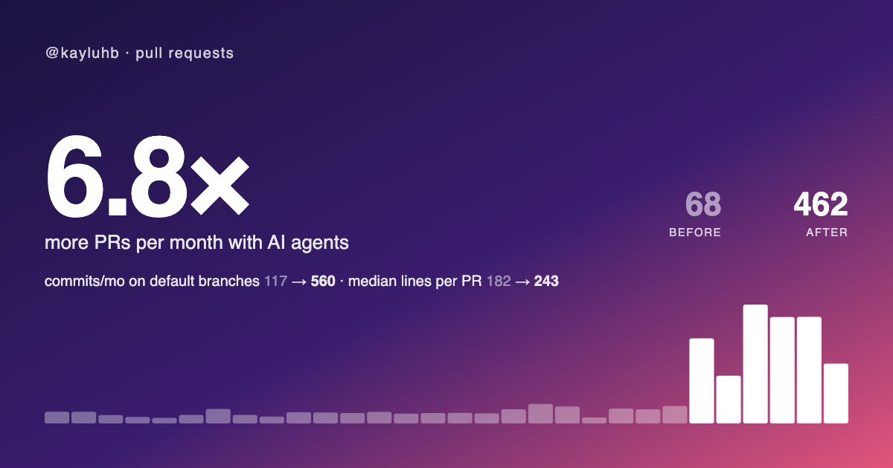

# agent-era

How much more do you ship since you started working with AI coding agents? `agent-era` is a Claude Code plugin that reads your own GitHub history through the `gh` CLI you're already logged in to, and makes a share card comparing your output before and after.



It counts private repos and every org your `gh` login can see. It runs on your machine, needs no sign-up, and takes about 2–3 minutes for a heavy GitHub user.

## Install

In Claude Code:

```
/plugin marketplace add kayluhb/agent-era
/plugin install agent-era@agent-era
```

## Use

```
/agent-era
```

Claude runs the script, tells you your headline number, and writes `agent-era-<your-login>.png` to the current folder.

You can also run the script directly:

```bash
node bin/agent-era.js [--since YYYY-MM] [--out path.png] [--no-commits] [--no-lines] [--theme default] [--chart-from YYYY-MM]
```

| Flag | What it does |
| --- | --- |
| `--since YYYY-MM` | Set the month your agent era started, instead of detecting it |
| `--out PATH` | Where to write the card (default `./agent-era-<login>.png`) |
| `--no-commits` | Skip commit counts (faster) |
| `--no-lines` | Skip the merged-PR sample: lines changed, time to merge, repos (faster) |
| `--chart-from YYYY-MM` | Start the bar chart at this month, like `2016-01` (default: 24 months before the agent era). The numbers don't change |
| `--theme default` | Use the default charcoal and amber colors instead of your terminal's |

## Colors

The card uses your terminal's colors. agent-era reads the background and text color from your terminal's settings, and picks one accent at random from its ANSI colors, so each run can look a little different. It skips red, because a red "after" reads as bad news, and it skips any color that would be hard to read on your background.

This works for iTerm2, Ghostty, kitty and Alacritty. For other terminals, or if the colors would make an unreadable card, it uses the default charcoal and amber colors. The summary says which colors it used.

## How the numbers work

**The agent-era line.** agent-era looks for the month where your PRs jumped: the month whose next three months average at least 2× the 12 months before it (from 2023 on, full months only). If it finds no jump, it uses February 2025, when Claude Code launched. Use `--since` if it picked the wrong month.

**The multiplier.** "Before" is your average PRs per month over the 12 full months before the line. "After" is your average over the full months since. The current month is never counted, because it isn't over yet. If you had no PRs before the line, the card shows your after rate with no multiplier.

**Commits** are counted on each repo's default branch only, which is what GitHub's commit search covers. A squash-merged branch counts as one commit.

**The merged-PR sample** is up to 500 merged PRs on each side of the line. **Lines changed** is the median of additions + deletions per PR, so one giant generated file or lockfile can't inflate it. **Time to merge** is the median hours from opening to merging. The summary also counts the distinct repos and languages in the sample. Those counts depend on the sample size, so they stay off the card.

**Claude co-authored** is the share of your default-branch commits since the line that carry a `Co-Authored-By: Claude` trailer. Claude Code adds this trailer by default. Other agents don't, so their commits aren't counted here.

**Merge rate** is merged PRs ÷ opened PRs, by the month each PR was opened. Recent months read a little low because some of their PRs are still open.

**Reviews** counts other people's PRs you reviewed, by the month each PR was opened. **Active days** counts days with any contribution on your GitHub contribution calendar. Private work counts only if your profile shows private contributions.

## What goes on the card

Below the headline there's room for up to three stats, and agent-era picks them for you:

1. Claude co-authored, if it's at least 10% of your commits.
2. The stats that improved the most (commits, reviews, active days, lines per PR, time to merge), if they changed by at least 1.25×. Fewer reviews, fewer commits or slower merges never make the card. Lines per PR can go either way, because smaller PRs are a fine result too.
3. Merge rate, if it's at least 80% and hasn't dropped.

Everything else is in the summary, including your best month and how many months in a row you've beaten your pre-agent average.

## Privacy

- The script talks only to GitHub's API, through your own `gh` login. Nothing is stored or sent anywhere else.
- The card shows your GitHub handle and aggregate counts only. It never shows repo or org names.
- When you run it through Claude Code, the summary (aggregate counts, no repo names) passes through your Claude session so Claude can tell you about it.

If one of your orgs requires SSO and hasn't authorized the GitHub CLI, its PRs won't be counted. agent-era tells you when it detects this.

## Requirements

- Node.js 22 or newer
- [GitHub CLI](https://cli.github.com), logged in (`gh auth login`)
- Google Chrome or Chromium to make the PNG. Without it, you get an SVG instead. Set `CHROME_PATH` if Chrome is somewhere unusual.

## Development

```bash
npm install   # dev tools only (Biome)
npm test
npm run check
```
